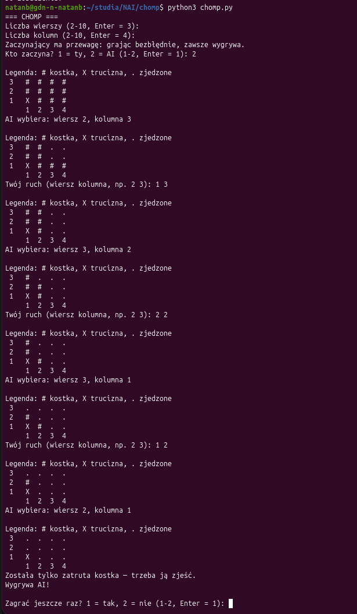

# Chomp

**Autorzy:** Natan Brzozowski, Patryk Szachniewicz

## Zasady gry

- Plansza to tabliczka czekolady złożona z kostek.
- Gracze wykonują ruchy na zmianę.
- Ruch polega na wybraniu kostki i zjedzeniu jej razem ze wszystkimi kostkami na prawo i powyżej niej.
- Lewa dolna kostka (pole `1 1`) jest zatruta — kto ją zje, przegrywa.
- Gdy zostaje sama zatruta kostka, gracz, który ma ruch, musi ją zjeść.
- W grze nie ma losowości ani remisów: zawsze jeden gracz wygrywa, a drugi przegrywa.

## Uruchomienie

1. Zainstaluj Python 3.8 lub nowszy. Gra nie wymaga dodatkowych bibliotek.
2. Pobierz repozytorium i przejdź do katalogu gry:
   ```
   git clone https://github.com/s30576-pj/NAI.git
   cd NAI/chomp
   ```
3. Uruchom grę:
   ```
   python chomp.py
   ```

## Jak grać

1. Wybierz liczbę wierszy i kolumn (od 2 do 10). Sam Enter wybiera planszę 3×4.
2. Wybierz, kto zaczyna: ty czy AI. Zaczynający ma przewagę — grając bezbłędnie, zawsze wygrywa.
3. Ruch wpisujesz jako `wiersz kolumna`, np. `2 3`.
4. Oznaczenia na planszy: `#` kostka, `X` zatruta kostka, `.` zjedzone pole.
5. Grę można zakończyć w dowolnym momencie przez Ctrl+C.

## Jak działa AI

AI korzysta z algorytmu **Minimax**, czyli przeszukiwania z uwzględnieniem przeciwnika (adversarial search):

- ocenia pozycję jako `1` (AI wygra) albo `-1` (AI przegra),
- w swojej turze wybiera najlepszy wynik dla siebie (max),
- zakłada, że człowiek wybierze najgorszy wynik dla AI (min),
- analizuje grę aż do samego końca, bez heurystyki i limitu głębokości.

Dwa usprawnienia, dzięki którym nawet na planszy 10×10 ruch AI trwa około sekundy:

1. **Zapamiętywanie wyników** (`@lru_cache(maxsize=None)`) — każda pozycja jest liczona tylko raz.
2. **Przerwanie szukania**, gdy znaleziono najlepszy możliwy wynik — lepszego niż wygrana nie ma.

Gdy AI nie może wygrać, wybiera ruch, po którym zostaje najwięcej kostek, żeby przedłużyć grę.
Podczas liczenia wyświetla animowany napis „AI myśli...”.

## Przykładowa rozgrywka


