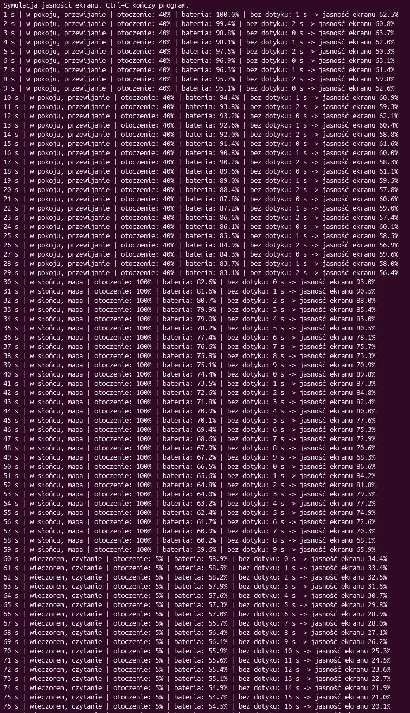

# Automatyczna jasność ekranu telefonu

**Autorzy:** Natan Brzozowski, Patryk Szachniewicz

Program sam dobiera jasność ekranu telefonu za pomocą logiki rozmytej. Bierze pod
uwagę jasność otoczenia, poziom baterii i to, ile czasu minęło od ostatniego
dotknięcia ekranu.

## Uruchomienie

1. Zainstaluj Python 3.8 lub nowszy. Program nie wymaga dodatkowych bibliotek.
2. Pobierz repozytorium i przejdź do katalogu programu:
   ```
   git clone https://github.com/s30576-pj/NAI.git
   cd NAI/jasnosc-ekranu
   ```
3. Uruchom program:
   ```
   python jasnosc_ekranu.py
   ```
   (Linux/macOS: `python3 jasnosc_ekranu.py`)
4. Program kończy się sam, gdy bateria się rozładuje (po ok. 3,5 minuty), albo skrótem Ctrl+C.

## Działanie

Program wykonuje jeden krok na sekundę:

1. Jeśli użytkownik dotknął ekranu, licznik czasu bez dotyku się zeruje. Jeśli nie, rośnie o 1.
2. Logika rozmyta oblicza jasność ekranu.
3. Ekran zużywa baterię: im jaśniej, tym szybciej (przy jasności 100% ubywa 1% baterii na sekundę).

Sposób używania telefonu zmienia się co 30 s:

- **w pokoju, przewijanie** - otoczenie 40%, dotknięcie ekranu co 3 s,
- **w słońcu, mapa** - otoczenie 100%, dotknięcie ekranu co 10 s,
- **wieczorem, czytanie** - otoczenie 5%, dotknięcie ekranu co 20 s.

Po ostatnim sposobie wraca pierwszy.

## Logika rozmyta

**Trzy wejścia:**

1. X1 - jasność otoczenia w % (0 = ciemno, 100 = pełne słońce).
2. X2 - poziom baterii w %.
3. X3 - ile sekund minęło od ostatniego dotknięcia ekranu.

**Jedno wyjście:** jasność ekranu w % (od 5 do 100).

Sterownik działa w trzech krokach (metoda Sugeno):

1. **Rozmywanie** - każde wejście ma dwa zbiory: "mało" i "dużo". Stopień "dużo"
   rośnie liniowo od 0 do 1 w zakresie 0-100% (otoczenie, bateria) albo 0-30 s
   (czas bez dotyku), a stopień "mało" to 1 minus stopień "dużo". Na przykład
   9 s bez dotyku to "mało" w 0,7 i "dużo" w 0,3.
2. **Reguły** - 8 reguł, po jednej dla każdej kombinacji zbiorów. Siła reguły to
   iloczyn stopni jej trzech warunków.
3. **Wyostrzanie** - wynik to średnia ważona jasności z reguł.

| X1 (otoczenie) | X2 (bateria) | X3 (czas bez dotyku) | Jasność ekranu [%] |
|---|---|---|---|
| mało | mało | mało | 20 |
| mało | mało | dużo | 5 |
| mało | dużo | mało | 40 |
| mało | dużo | dużo | 10 |
| dużo | mało | mało | 60 |
| dużo | mało | dużo | 15 |
| dużo | dużo | mało | 100 |
| dużo | dużo | dużo | 30 |

Jaśniejsze otoczenie i więcej baterii rozjaśniają ekran. Dłuższy czas bez dotyku
go przyciemnia.

**Przykład:** X1 = 50%, X2 = 50%, X3 = 15 s. Każdy stopień wynosi 0,5, więc każda
reguła ma siłę 0,5 * 0,5 * 0,5 = 0,125.
Wynik to (20 + 5 + 40 + 10 + 60 + 15 + 100 + 30) / 8 = **35%**.

Źródło metody: [MathWorks - Mamdani and Sugeno Fuzzy Inference Systems](https://www.mathworks.com/help/fuzzy/types-of-fuzzy-inference-systems.html).

## Przykładowe uruchomienie


