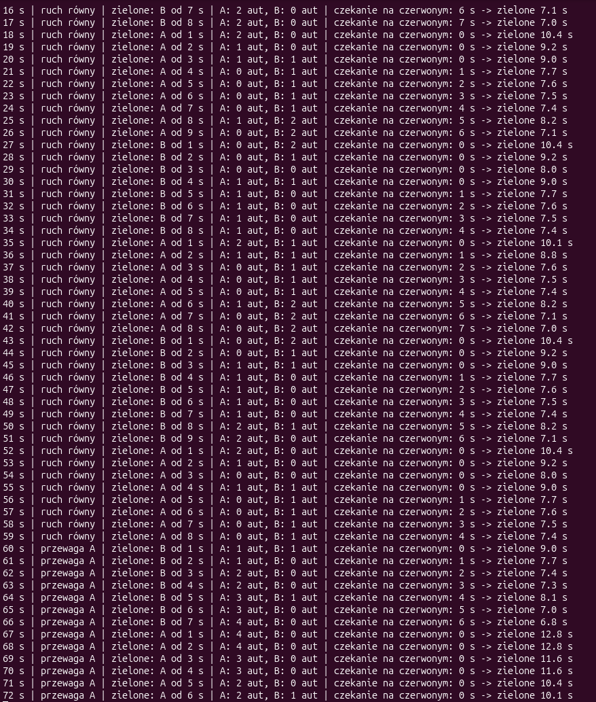

# Adaptacyjna sygnalizacja świetlna

**Autorzy:** Natan Brzozowski, Patryk Szachniewicz

Program symuluje skrzyżowanie dwóch kierunków ruchu, A i B. Sterownik oparty
na logice rozmytej sam dobiera, jak długo ma trwać zielone światło, na podstawie
długości kolejek aut i czasu czekania na czerwonym.

## Uruchomienie

1. Zainstaluj Python 3.8 lub nowszy. Program nie wymaga dodatkowych bibliotek.
2. Pobierz repozytorium i przejdź do katalogu programu:
   ```
   git clone https://github.com/s30576-pj/NAI.git
   cd NAI/sygnalizacja-rozmyta
   ```
3. Uruchom program:
   ```
   python sygnalizacja.py
   ```
   (Linux/macOS: `python3 sygnalizacja.py`)
4. Zakończ program skrótem Ctrl+C.

## Działanie

Program wykonuje jeden krok na sekundę:

1. Do kolejek dołączają nowe auta.
2. Logika rozmyta oblicza, ile sekund ma trwać zielone.
3. Na zielonym przejeżdża jedno auto.
4. Gdy zielone trwa już tyle, ile wyliczyła logika rozmyta, zielone dostaje drugi kierunek.

Natężenie ruchu zmienia się samo co 60 s:

- **ruch równy** — auto w A i w B co 5 s,
- **przewaga A** — auto w A co 2 s, w B co 8 s,
- **przewaga B** — auto w A co 8 s, w B co 2 s.

Kierunek z większym ruchem dostaje dłuższe zielone.

## Logika rozmyta

**Trzy wejścia:**

1. X1 — liczba aut na kierunku z zielonym światłem.
2. X2 — liczba aut na kierunku z czerwonym światłem.
3. X3 — ile sekund czeka pierwsze auto na czerwonym.

**Jedno wyjście:** ile sekund ma trwać zielone (od 5 do 20 s).

Sterownik działa w trzech krokach (metoda Sugeno):

1. **Rozmywanie** — każde wejście ma dwa zbiory: „mało” i „dużo”. Stopień „dużo”
   rośnie liniowo od 0 do 1 w zakresie 0–10 aut (kolejki) albo 0–30 s (czekanie),
   a stopień „mało” to 1 minus stopień „dużo”. Na przykład 3 auta to „mało” w 0,7
   i „dużo” w 0,3.
2. **Reguły** — 8 reguł, po jednej dla każdej kombinacji zbiorów. Siła reguły to
   iloczyn stopni jej trzech warunków.
3. **Wyostrzanie** — wynik to średnia ważona czasów z reguł.

| X1 (zielone) | X2 (czerwone) | X3 (czekanie) | Czas zielonego [s] |
|---|---|---|---|
| mało | mało | mało | 8 |
| mało | mało | dużo | 5 |
| mało | dużo | mało | 6 |
| mało | dużo | dużo | 5 |
| dużo | mało | mało | 20 |
| dużo | mało | dużo | 10 |
| dużo | dużo | mało | 14 |
| dużo | dużo | dużo | 6 |

Więcej aut na zielonym wydłuża zielone. Więcej aut lub dłuższe czekanie na
czerwonym je skraca.

**Przykład:** X1 = 5 aut, X2 = 5 aut, X3 = 15 s. Każdy stopień wynosi 0,5, więc
każda reguła ma siłę 0,5 · 0,5 · 0,5 = 0,125.
Wynik to (8 + 5 + 6 + 5 + 20 + 10 + 14 + 6) / 8 = **9,25 s**.

Źródło metody: [MathWorks — Mamdani and Sugeno Fuzzy Inference Systems](https://www.mathworks.com/help/fuzzy/types-of-fuzzy-inference-systems.html).

## Przykładowe uruchomienie


